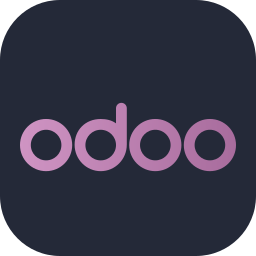

## Sobre mí

Desarrollador **Full Stack** especializado en **backend**, **arquitectura de software** y construcción de **aplicaciones escalables**.

- **Backend:** Java + Spring Boot o Python + FastAPI.
- **Cómo trabajo:** arquitectura limpia, modularidad, seguridad y mantenibilidad.
- **Web y móvil:** Vue.js y React en web, React Native en móvil.
- **ERP:** desarrollo de soluciones con Odoo 19.
- **Alcance:** desde APIs y servicios backend hasta la integración de aplicaciones completas.

## Stack tecnológico

<table width="900" align="center">
  <tr>
    <td width="50%" align="center" valign="top">
       
      <h3>Backend</h3>
       
      
        
    </td>
    <td width="50%" align="center" valign="top">
       
      <h3>Web y Móvil</h3>
       
      
       
      React Native en móvil
        
    </td>
  </tr>
  <tr>
    <td width="50%" align="center" valign="top">
       
      <h3>Bases de Datos</h3>
       
      
        
    </td>
    <td width="50%" align="center" valign="top">
       
      <h3>DevOps y Herramientas</h3>
       
      
        
    </td>
  </tr>
  <tr>
    <td colspan="2" align="center" valign="top">
       
      <h3>ERP</h3>
       
      
        
    </td>
  </tr>
</table>

## Estadísticas de GitHub

  
  &nbsp;
  

